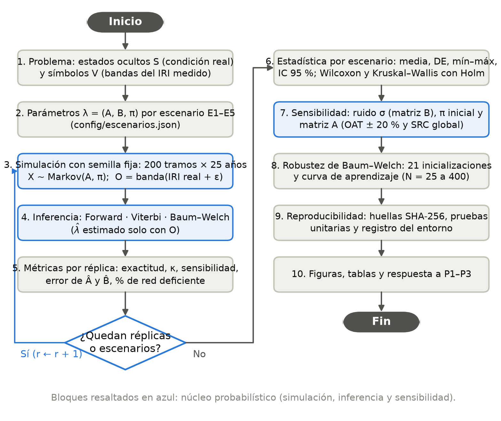
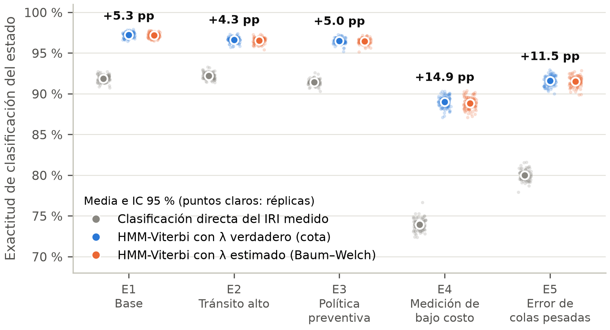
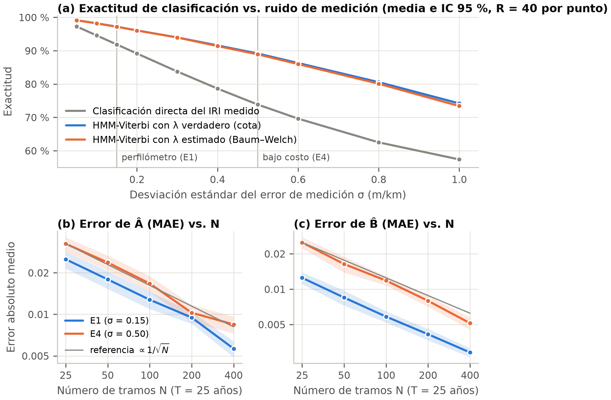

<!-- Fuente del artículo. Cada párrafo va en UNA sola línea. Las cifras §clave§ se rellenan desde resultados/ y las citas [@clave] se numeran en orden de aparición (IEEE) al compilar con: python articulo/construir_articulo.py -->
# Modelo oculto de Markov para inferir la condición real del pavimento a partir de mediciones ruidosas del IRI: formulación, simulación Monte Carlo y análisis de sensibilidad reproducible
%TITULO_EN A hidden Markov model to infer true pavement condition from noisy IRI measurements: formulation, Monte Carlo simulation and reproducible sensitivity analysis
%CENTRO Johan {{Apellido}}¹, Juan {{Apellido}}¹, Jhojan {{Apellido}}¹
%CENTRO ¹ {{Programa académico}}, {{Universidad}}, {{Ciudad}}, Colombia. Autor de correspondencia: {{correo institucional}}
%CENTRO Repositorio del código y los datos: {{URL del repositorio}} · Versión 1.0 · {{fecha de envío}}

## Resumen

La gestión de pavimentos clasifica cada tramo según su rugosidad, medida con el Índice de Rugosidad Internacional (IRI), pero el IRI medido contiene error, sobre todo con sensores de bajo costo. Este trabajo formula el problema como un modelo oculto de Markov (HMM) con cuatro estados de condición (Bueno, Regular, Malo y Crítico), una matriz de transición $A$ que combina deterioro y rehabilitación, y una matriz de emisión $B$ derivada analíticamente de la convolución entre la distribución uniforme del IRI real dentro de cada clase y el error de medición (normal o t de Student). Se implementó en Python un HMM propio (Forward, Viterbi y Baum–Welch escalados), verificado contra enumeración exhaustiva y contra hmmlearn, y se simularon cinco escenarios con §R§ réplicas de §N§ tramos durante §T§ años, con semillas fijas. Con perfilómetro (σ = 0.15 m/km), el HMM con parámetros estimados por Baum–Welch elevó la exactitud de clasificación del estado de §E1_dir§ % a §E1_bw§ %; con un sensor de bajo costo (σ = 0.50 m/km), de §E4_dir§ % a §E4_bw§ %, lo que reduce el error en §E4_red_err§ % (p §E4_p§). El modelo fue robusto a errores de colas pesadas; la proporción estacionaria de red deficiente fue más sensible a la transición Malo→Crítico y a la tasa de rehabilitación, y una política preventiva la redujo de §E1_pdef§ % a §E3_pdef§ %. Se aporta un marco abierto y reproducible para auditar indicadores de estado en redes y concesiones viales.

**Palabras clave:** modelo oculto de Markov; cadena de Markov; índice de rugosidad internacional; gestión de pavimentos; algoritmo de Baum–Welch; simulación Monte Carlo.

## Abstract

Pavement management classifies road segments by roughness, measured with the International Roughness Index (IRI), but measured IRI is noisy, especially with low-cost sensors. We formulate the problem as a hidden Markov model (HMM) with four condition states, a transition matrix combining deterioration and rehabilitation, and an emission matrix derived in closed form from the convolution of the within-class distribution of true IRI and the measurement error (Gaussian or Student-t). A purpose-built Python HMM (scaled Forward, Viterbi and Baum–Welch), verified against exhaustive enumeration and hmmlearn, was run on five scenarios with §R§ seeded replications of §N§ segments over §T§ years. With a profiler (σ = 0.15 m/km), the HMM with Baum–Welch estimates raised state-classification accuracy from §E1_dir§ % to §E1_bw§ %; with a low-cost sensor (σ = 0.50 m/km), from §E4_dir§ % to §E4_bw§ %, a §E4_red_err§ % error reduction. The model was robust to heavy-tailed errors; the long-run deficient share was most sensitive to the Poor→Critical transition and the rehabilitation rate, and a preventive policy lowered it from §E1_pdef§ % to §E3_pdef§ %. The study provides an open, reproducible framework to audit condition indicators in road networks and concessions.

**Keywords:** hidden Markov model; Markov chain; international roughness index; pavement management; Baum–Welch algorithm; Monte Carlo simulation.

## 1. Introducción

La condición de una red vial determina los costos de operación vehicular, la seguridad y la prioridad de las inversiones de mantenimiento. El indicador funcional más difundido es el Índice de Rugosidad Internacional (IRI, en m/km), estandarizado por el Banco Mundial [@sayers1986]. Con él, las agencias asignan cada tramo a una clase de condición; por ejemplo, la regulación federal de Estados Unidos califica como bueno un IRI menor de 95 in/mi (≈ 1.50 m/km) y como malo uno mayor de 170 in/mi (≈ 2.68 m/km) [@fhwa2017]. En las concesiones viales, indicadores de este tipo sirven además para verificar niveles de servicio y activar intervenciones.

El problema es que la clase se asigna con el IRI **medido**, no con el real. La medición incorpora errores del equipo, la velocidad, el montaje y la variabilidad dentro del tramo; en los sistemas de bajo costo basados en teléfonos inteligentes, la repetibilidad depende de esas condiciones y se ha observado una tendencia a sobrestimar la rugosidad [@yu2023]. Un tramo cercano a un umbral puede cambiar de clase sin que su condición cambie, lo que genera intervenciones innecesarias u omitidas y distorsiona los modelos de deterioro estimados con esos datos.

Las cadenas de Markov [@markov1906; @norris1997] se usan ampliamente para modelar el deterioro por estados [@alonso2023; @tran2023], y los modelos ocultos de Markov (HMM) [@rabiner1989] separan el estado latente de la observación ruidosa; en infraestructura se han usado para tratar errores y sesgos de inspección [@kobayashi2012; @lethanh2013]. Los HMM tienen amplia aplicación [@mor2021], pero su estimación puede quedar atrapada en máximos locales que dependen de los valores iniciales [@zucchini2016], y su uso aplicado presenta trampas metodológicas menos conocidas, como la desalineación temporal entre procesos o la dificultad de vincular el estado oculto con el entorno [@glennie2023]. Un estudio con estándar de revista de alto impacto debe, además, ser computacionalmente reproducible [@heil2021] e incluir un análisis de sensibilidad sistemático [@razavi2021].

Este trabajo responde tres preguntas: **P1:** ¿cómo puede representarse la condición real de un tramo, observada mediante el IRI medido, con un modelo de Markov oculto? **P2:** ¿cómo influyen los parámetros ($A$, $B$, $\pi$) y la distribución del error de medición en los resultados de simulación? **P3:** ¿qué tan reproducible y sensible es el modelo frente a cambios en las condiciones iniciales y en las matrices de transición y emisión? El objetivo general es diseñar, implementar y evaluar un HMM ejecutable que infiera la condición real del pavimento; los objetivos específicos son formular el modelo, derivar $B$ a partir del error del sensor, implementar y verificar los algoritmos, y cuantificar su desempeño y sensibilidad mediante simulación. Los aportes son:

- una formulación en la que $B$ se deriva en forma cerrada de los umbrales del IRI y de la distribución del error del sensor;
- una implementación abierta y verificada de Forward, Viterbi y Baum–Welch, con semillas fijas y huellas SHA-256 de los resultados;
- una evaluación Monte Carlo de cinco escenarios con estadística inferencial y sensibilidad a σ, $\pi$, $A$ y a la inicialización;
- evidencia cuantitativa para decidir la precisión requerida del sensor y la política de intervención.

## 2. Estado del arte

Se hizo una revisión estructurada breve en Google Scholar y en los portales de Elsevier, Taylor & Francis, ASCE, SAGE y MDPI, combinando los términos *hidden Markov model*, *Markov chain*, *pavement*, *road*, *roughness*, *IRI*, *deterioration* y *smartphone*. Se priorizaron artículos revisados por pares de 2021 a 2026, más trabajos clásicos sobre HMM en infraestructura, con tres criterios: modelo probabilístico explícito; aplicación a deterioro, fiabilidad o medición de rugosidad, y relación con estados latentes o error de medición. La búsqueda no es exhaustiva; la Tabla 1 sintetiza los trabajos seleccionados.

En pavimentos predominan las cadenas de Markov **visibles**, que tratan la clase observada como estado real: matrices de transición estimadas con IRI de la red española [@alonso2023], pronósticos de red y presupuesto con un índice compuesto de fisuras, ahuellamiento y rugosidad [@tran2023], el efecto del mantenimiento en la matriz de transición [@isradi2024] y modelos de riesgo markovianos con la lluvia como covariable [@shakya2025]; Sasai *et al.* [@sasai2025] proponen, en cambio, un proceso de deterioro continuo y multidimensional. Los enfoques con estado **latente** son menos frecuentes: Kobayashi *et al.* [@kobayashi2012] formularon un HMM que considera los sesgos y errores de inspección, y Lethanh y Adey [@lethanh2013], un HMM exponencial donde el indicador medido es la señal de una condición no observable. En fiabilidad y mantenimiento se han derivado medidas de fiabilidad a partir de HMM [@gamiz2023a; @gamiz2023b] y se ha estimado la vida útil remanente con un HMM discreto [@aggab2022]. En medición, Yu *et al.* [@yu2023] propusieron un marco para evaluar sistemas de rugosidad con teléfonos inteligentes.

[[TABLA:estado_arte|Comparación de trabajos previos sobre modelos de Markov para deterioro, fiabilidad y medición de rugosidad.|TPM: matriz de probabilidades de transición; M&R: mantenimiento y rehabilitación. La última columna es interpretación de los autores.]]

**Vacío identificado.** En los trabajos revisados no encontramos un estudio que, con un diseño Monte Carlo reproducible, cuantifique de forma conjunta (a) cuánto ruido de medición tolera la inferencia del estado real, (b) su sensibilidad a la forma de la distribución del error y (c) la sensibilidad de los indicadores de red a $A$ y $\pi$. Este trabajo aborda ese vacío con un HMM cuya matriz de emisión se deriva de la física de la medición.

## 3. Marco teórico

### 3.1 Cadenas de Markov

Una sucesión $\{X_t\}$ con valores en $S = \{s_1, \ldots, s_K\}$ es una cadena de Markov homogénea si cumple la propiedad de Markov [@markov1906; @norris1997]:

$$P(X_{t+1}=s_j \mid X_t=s_i, X_{t-1}, \ldots, X_1) = P(X_{t+1}=s_j \mid X_t=s_i) = a_{ij}$$ (1)

Cada fila de $A = [a_{ij}]$ es una distribución **categórica**: $X_{t+1} \mid X_t = s_i \sim \mathrm{Cat}(a_{i1}, \ldots, a_{iK})$. Por Chapman–Kolmogorov, $\boldsymbol{\pi}_t = \boldsymbol{\pi}_0 A^{t}$; si la cadena es irreducible y aperiódica, existe una única distribución estacionaria

$$\boldsymbol{\pi}^{*} A = \boldsymbol{\pi}^{*}, \quad \sum_{i=1}^{K} \pi^{*}_i = 1$$ (2)

y la distancia de variación total decae geométricamente: si $A$ es diagonalizable, $\| \boldsymbol{\pi}_t - \boldsymbol{\pi}^{*} \|_{\mathrm{TV}} \le C\, |\lambda_2|^{t}$, con $\lambda_2$ el segundo valor propio de mayor módulo [@levin2017]. El tiempo de permanencia $D_i$ en $s_i$ es **geométrico**, y el tiempo medio hasta alcanzar un conjunto de estados se obtiene con la matriz fundamental, siendo $Q$ la submatriz de $A$ de los estados que aún no lo alcanzan [@norris1997]:

$$P(D_i = d) = (1-a_{ii})\, a_{ii}^{d-1}, \quad E[D_i] = \frac{1}{1-a_{ii}}, \quad \mathbf{m} = (I - Q)^{-1}\mathbf{1}$$ (3)

### 3.2 Modelo oculto de Markov

Un HMM discreto se define por $\lambda = (A, B, \pi)$ [@rabiner1989]: estados ocultos $S$, símbolos observables $V = \{v_1, \ldots, v_M\}$, matriz de transición $A$, matriz de emisión $B = [b_j(k)]$ con $b_j(k) = P(O_t = v_k \mid X_t = s_j)$ y distribución inicial $\pi_i = P(X_1 = s_i)$. Con la propiedad de Markov y la independencia condicional de las observaciones,

$$P(O, X \mid \lambda) = \pi_{x_1} b_{x_1}(o_1) \prod_{t=2}^{T} a_{x_{t-1}x_t}\, b_{x_t}(o_t)$$ (4)

Los tres problemas clásicos [@rabiner1989] se resuelven así. **Evaluación**, con el algoritmo Forward en $O(K^2T)$:

$$\alpha_{t+1}(j) = \left[\sum_{i=1}^{K} \alpha_t(i)\, a_{ij}\right] b_j(o_{t+1}), \quad P(O \mid \lambda) = \sum_{i=1}^{K} \alpha_T(i)$$ (5)

**Decodificación**, con el algoritmo de Viterbi [@viterbi1967], que halla la secuencia de estados más probable:

$$\delta_{t+1}(j) = \underset{1 \le i \le K}{\mathrm{max}} \left[\delta_t(i)\, a_{ij}\right] b_j(o_{t+1}), \quad \psi_{t+1}(j) = \underset{1 \le i \le K}{\mathrm{argmax}} \left[\delta_t(i)\, a_{ij}\right]$$ (6)

**Aprendizaje**, con Baum–Welch [@baum1970], caso particular del algoritmo EM [@dempster1977], que usa las variables Forward ($\alpha$) y Backward ($\beta$):

$$\gamma_t(i) = \frac{\alpha_t(i)\beta_t(i)}{P(O \mid \lambda)}, \quad \xi_t(i,j) = \frac{\alpha_t(i)\, a_{ij}\, b_j(o_{t+1})\, \beta_{t+1}(j)}{P(O \mid \lambda)}$$ (7)

$$\bar{a}_{ij} = \frac{\sum_{t=1}^{T-1} \xi_t(i,j)}{\sum_{t=1}^{T-1} \gamma_t(i)}, \quad \bar{b}_j(k) = \frac{\sum_{t:\, o_t = v_k} \gamma_t(j)}{\sum_{t=1}^{T} \gamma_t(j)}, \quad \bar{\pi}_i = \gamma_1(i)$$ (8)

Cada iteración no disminuye la verosimilitud [@dempster1977], pero puede converger a máximos locales, por lo que conviene probar varios valores iniciales [@zucchini2016]; las entradas nulas de $A$ permanecen nulas, lo que permite imponer la estructura del deterioro.

### 3.3 Distribuciones de la emisión

Sea $U$ el IRI real del tramo e $Y = U + \varepsilon$ el IRI medido. Se supone $U \mid X_t = s_j \sim \mathcal{U}(\ell_j, u_j)$ (**uniforme** continua dentro de la clase) y un error de media cero y desviación estándar σ, **normal** o **t de Student** con ν grados de libertad reescalada:

$$\varepsilon \sim \mathcal{N}(0,\sigma^2) \quad \text{o} \quad \varepsilon = \sigma\sqrt{\frac{\nu-2}{\nu}}\, T_\nu, \; T_\nu \sim t_\nu$$ (9)

Con umbrales $c_0 = -\infty < c_1 < c_2 < c_3 < c_4 = +\infty$, el símbolo observado es la banda que contiene a $Y$ y $b_j(k) = F_j(c_k) - F_j(c_{k-1})$, donde $F_j$ es la función de distribución de $Y$ en $s_j$. En el caso normal, la convolución uniforme–normal tiene forma cerrada, con $\Phi$ y $\varphi$ la distribución y la densidad normal estándar; para la t de Student, $F_j$ se integra numéricamente:

$$F_j(c) = \frac{\sigma}{u_j-\ell_j}\left[G\left(\frac{c-\ell_j}{\sigma}\right) - G\left(\frac{c-u_j}{\sigma}\right)\right], \quad G(z) = z\,\Phi(z) + \varphi(z)$$ (10)

## 4. Metodología

### 4.1 Diseño de la solución

La Fig. 1 resume las fases: definición del problema, especificación de $\lambda$ por escenario, simulación con semillas fijas, inferencia (Forward, Viterbi y Baum–Welch), métricas, estadística, sensibilidad y reproducibilidad. El estudio de simulación sigue la estructura de objetivos, mecanismo generador de datos, estimandos, métodos y medidas de desempeño de Morris *et al.* [@morris2019].

{ancho=11.5}

### 4.2 Especificación formal del modelo

**Estados ocultos:** $S$ = {Bueno, Regular, Malo, Crítico}, con IRI real en [0.80, 1.50), [1.50, 2.68), [2.68, 4.00) y [4.00, 6.00] m/km; los dos primeros umbrales son los de 95 y 170 in/mi [@fhwa2017] y el de 4.00 m/km es un supuesto del estudio. **Símbolos:** $V = \{v_1, \ldots, v_4\}$, las mismas bandas aplicadas al IRI **medido**. **Paso:** un año. **Transición:** $A$ se parametriza con probabilidades anuales de deterioro ($d$), intervención preventiva en Malo ($r_M$), rehabilitación en Crítico ($r_C$) y un factor de tránsito $f$:

$$A = \left(\begin{matrix} 1-f(d_{BR}+d_{BM}) & f d_{BR} & f d_{BM} & 0 \\ 0 & 1-f(d_{RM}+d_{RC}) & f d_{RM} & f d_{RC} \\ r_M & 0 & (1-r_M)(1-f d_{MC}) & (1-r_M) f d_{MC} \\ r_C & 0 & 0 & 1-r_C \end{matrix}\right)$$ (11)

Los valores base (Tabla 2) implican permanencias medias de 6.7, 5.0, 4.5 y 2.9 años en Bueno, Regular, Malo y Crítico, y §E1_mfpt§ años en promedio para que un tramo nuevo llegue a la condición deficiente (Malo o Crítico). Son supuestos plausibles, no calibrados con una red específica, por lo que se someten a un análisis de sensibilidad de ±20 %. La rehabilitación hace la cadena irreducible y aperiódica, de modo que $\boldsymbol{\pi}^{*}$ existe. **Emisión:** $B$ se calcula con (10). **Distribución inicial:** $\pi_0$ = (0.40, 0.30, 0.20, 0.10), una red envejecida. La Fig. 2 muestra $A$ y las matrices $B$.

{ancho=13}

### 4.3 Escenarios y diseño experimental

E2 y E3 modifican $A$ (tránsito alto y política preventiva) y E4 y E5 modifican $B$ (sensor de bajo costo con error normal y con error t₃, ambos con σ = 0.50 m/km), de modo que E4 frente a E5 aísla el efecto de la **forma** de la distribución con igual varianza (Tabla 2).

[[TABLA:escenarios|Escenarios de simulación y parámetros del modelo.|$d$: probabilidad anual de deterioro; $r_M$, $r_C$: probabilidad anual de intervención en Malo y de rehabilitación en Crítico (el tramo vuelve a Bueno); $f$: factor de tránsito; σ: desviación estándar del error de medición del IRI. En todos los escenarios, $\pi_0$ = (0.40, 0.30, 0.20, 0.10).]]

Cada escenario tuvo R = §R§ réplicas independientes de §N§ tramos de 1 km durante §T§ años (§NT§ pares tramo-año). En cada réplica se comparan tres clasificadores del estado: la **clasificación directa** (banda del IRI medido), Viterbi con el $\lambda$ verdadero (cota superior) y Viterbi con $\hat{\lambda} = (\hat{A}, \hat{B}, \hat{\pi})$ estimado por Baum–Welch **solo con las observaciones** (caso realista). Baum–Welch se inicializa con la estructura de ceros de $A$ (filas uniformes sobre las transiciones posibles), $B^{(0)}$ con diagonal 0.70 y $\pi^{(0)}$ uniforme, y se detiene cuando la mejora relativa de la log-verosimilitud es menor que 10⁻⁷ (Algoritmo 1).

```**Algoritmo 1.** Procedimiento Monte Carlo para un escenario e (`hmm_pavimento/experimentos.py`)
Entrada: λ_e = (A, B, π), N, T, R, semilla maestra s
para r = 1, …, R:
  g_r ← PCG64(SeedSequence([s, 1, e]).spawn(R)[r])        ▷ flujo aleatorio independiente
  X ← SimularCadena(A, π, N, T; g_r)                      ▷ X_t | X_t−1 = s_i ~ Cat(a_i·)
  Y ← Uniforme(ℓ_X, u_X) + ε,  ε ~ D(0, σ²)               ▷ IRI medido, ecuación (9)
  O ← Banda(Y; 1.50, 2.68, 4.00)                          ▷ símbolos observados
  X̂_dir ← O ;   X̂_ver ← Viterbi(O; λ_e)                   ▷ línea base y cota superior
  repetir                                                 ▷ Baum–Welch, ecuaciones (5), (7), (8)
    (α̂, c) ← Forward escalado(O; λ̂) ;  β̂ ← Backward escalado(O, c; λ̂)
    γ, ξ ← posteriores ;  λ̂ ← reestimación de π̂, Â, B̂
  hasta que la mejora relativa de log P(O | λ̂) < 10⁻⁷
  X̂_hmm ← Viterbi(O; λ̂) ;  guardar métricas(X, X̂_dir, X̂_ver, X̂_hmm, λ̂, λ_e)
salida: media, DE, mínimo, máximo e IC 95 % de cada métrica; pruebas estadísticas
```

Las métricas fueron: exactitud (proporción de pares tramo-año con estado correcto), kappa de Cohen, sensibilidad y precisión para detectar tramos deficientes, error absoluto medio (MAE) de $\hat{A}$ (entradas no nulas) y de $\hat{B}$, y error en la proporción deficiente del último año. Se reportan media, desviación estándar (DE), mínimo, máximo e IC 95 % de la media, $\bar{y} \pm t_{0.975,\,R-1}\, s/\sqrt{R}$. La mejora del HMM se contrastó con la prueba de Wilcoxon pareada y el tamaño de efecto $d_z$; los escenarios, con Kruskal–Wallis y pruebas de Mann–Whitney frente a E1 con el estadístico A₁₂ de Vargha–Delaney; los valores p se ajustaron por Holm. La sensibilidad incluyó: σ entre §sig_min§ y §sig_max§ m/km (R = §R_sigma§ por valor); N entre 25 y 400 tramos (R = §R_tamano§); tres distribuciones iniciales; variaciones de ±20 % de los parámetros de $A$ uno a la vez (OAT) y un análisis global con §n_glob§ muestras y coeficientes de regresión estandarizados (SRC) [@razavi2021], y 20 inicializaciones aleatorias de Baum–Welch.

### 4.4 Entorno de trabajo

El modelo se implementó desde cero en Python §py§ con NumPy [@harris2020] y SciPy [@virtanen2020]; hmmlearn se usó solo para validar. Todo el flujo se ejecuta con `python ejecutar_todo.py` y los parámetros están en `config/escenarios.json`. Las §n_pruebas§ pruebas unitarias verifican, entre otros puntos, que Forward y Viterbi coinciden con la enumeración exhaustiva de los $K^T$ caminos, que el simulador reproduce las frecuencias de $B$ y que Baum–Welch es monótono (versiones en la Tabla B1 del Anexo B).

## 5. Resultados

### 5.1 Propiedades analíticas de los escenarios

Con tránsito alto (E2), la proporción estacionaria de red deficiente sube de §E1_pdef§ % a §E2_pdef§ % y el tiempo medio de Bueno a deficiente baja de §E1_mfpt§ a §E2_mfpt§ años; la política preventiva (E3) la reduce a §E3_pdef§ %, con §E3_interv§ intervenciones por 100 km-año frente a §E1_interv§ (Tabla 3). La exactitud esperada de la clasificación directa en estado estacionario, $\sum_j \pi^{*}_j b_j(j)$, fue §E1_dir_est§ %, §E4_dir_est§ % y §E5_dir_est§ % en E1, E4 y E5, casi idéntica a la simulada (Tabla 4), lo que valida el simulador.

[[TABLA:analitica|Propiedades analíticas de la cadena oculta y de la emisión por escenario.|π* deficiente: proporción estacionaria en Malo o Crítico; años de Bueno a deficiente: tiempo medio de primer paso (3); t_mez: primer año con distancia de variación total a π* ≤ 0.01 desde cualquier estado inicial; diag(B): probabilidad media de que la banda medida coincida con el estado real.]]

### 5.2 Recuperación del estado oculto

La Tabla 4 reporta los estadísticos de las §n_replicas_total§ réplicas y la Fig. 3 compara los escenarios (la Fig. B1 del Anexo B ilustra un tramo). Con perfilómetro (E1–E3), el HMM con $\hat{\lambda}$ mejoró la exactitud entre §rango_gan_bajo§ y §rango_gan_alto§ puntos porcentuales (pp); con el sensor de bajo costo (E4), pasó de §E4_dir§ % a §E4_bw§ % (+§E4_gan§ pp), y con error de colas pesadas (E5), de §E5_dir§ % a §E5_bw§ % (+§E5_gan§ pp). Estimar los parámetros en lugar de conocerlos costó como máximo §max_brecha§ pp. En E4, la sensibilidad para detectar tramos deficientes subió de §E4_sens_dir§ % a §E4_sens_bw§ % y la precisión, de §E4_prec_dir§ % a §E4_prec_bw§ %.

[[TABLA:montecarlo|Resultados Monte Carlo por escenario (R = §R§ réplicas de §N§ tramos × §T§ años): media ± DE, [IC 95 % de la media] y (mínimo–máximo).|MAE: error absoluto medio de las matrices estimadas por Baum–Welch frente a las verdaderas. Sensibilidad: proporción de pares tramo-año en Malo o Crítico identificados como tales.]]

{ancho=13.5}

Todas las mejoras fueron significativas (Wilcoxon con Holm, p §pmax_holm§) y grandes ($d_z$ entre §dz_min§ y §dz_max§; Tabla 5), y la exactitud del HMM difirió entre escenarios (Kruskal–Wallis H = §kw_H§, gl = §kw_gl§, p §kw_p§). Baum–Welch convergió en el §conv_bw§ % de las réplicas, con §iter_min§ a §iter_max§ iteraciones en promedio y sin permutaciones de etiquetas. La clasificación directa también distorsiona la dinámica: en E4, el §E4_tasa_mejora_observada§ % de las transiciones anuales observadas muestra una «mejora», aunque solo el §E4_tasa_mejora_real§ % corresponde a rehabilitaciones reales; así, el §E4_fraccion_espurias§ % de las mejoras observadas es espurio (§E1_fraccion_espurias§ % incluso con perfilómetro).

[[TABLA:pruebas|Pruebas estadísticas de la mejora del HMM con parámetros estimados (λ̂) frente a la clasificación directa.|Δ: diferencia media pareada en puntos porcentuales; d_z: tamaño de efecto pareado; A₁₂: probabilidad de que una réplica del escenario supere a una de E1 (0.5 = sin diferencia).]]

### 5.3 Sensibilidad a la matriz de emisión y al tamaño de muestra

Cuando σ aumenta de §sig_min§ a §sig_max§ m/km, la exactitud de la clasificación directa cae de §sig_dir_min§ % a §sig_dir_max§ %, mientras que el HMM con $\hat{\lambda}$ conserva entre §sig_bw_min§ % y §sig_bw_max§ % (Fig. 4a); la ganancia crece con el ruido y llega a §gan_max§ pp con σ = §sig_gan_max§ m/km. Para una exactitud del 90 %, la lectura directa exige σ ≤ §sig_dir_90§ m/km, mientras que el HMM la mantiene hasta σ ≈ §sig_bw_90§ m/km. La forma de la distribución también importa: con igual varianza, el error t₃ concentra más masa cerca de cero y la lectura directa acierta más que con error normal (§E5_dir§ % frente a §E4_dir§ %); suponer erróneamente error normal en el decodificador costó solo §E5_costo_gauss§ pp. El MAE de $\hat{A}$ y $\hat{B}$ decrece aproximadamente como $N^{-1/2}$ (Fig. 4b–c; pendientes log-log entre §E4_mae_A_pend§ y §E1_mae_B_pend§), como corresponde a un estimador de máxima verosimilitud consistente.

{ancho=13}

### 5.4 Sensibilidad a la distribución inicial y a la matriz de transición

Aunque la red deficiente inicial fue §pdef0_nueva§ %, §pdef0_envejecida§ % y §pdef0_deteriorada§ % según $\pi_0$, a los 10 años era §pdef10_nueva§ %, §pdef10_envejecida§ % y §pdef10_deteriorada§ %, y la distancia de variación total bajó de 0.01 en los años §tmix_nueva§, §tmix_envejecida§ y §tmix_deteriorada§ (red nueva, envejecida y deteriorada), al ritmo de |λ₂| = §E1_lam2§ (Fig. 5a–b): el largo plazo es insensible a $\pi_0$, pero los primeros años no. En $A$ (Fig. 5c), los parámetros más influyentes sobre $\pi^{*}$ deficiente fueron $d_{MC}$ (rango de §oat_d_MC§ pp con ±20 %) y $r_C$ (§oat_r_C§ pp). El signo de $d_{MC}$ es contraintuitivo: reducirlo **aumenta** la red deficiente (+§oat_d_MC_menos§ pp), porque con una política correctiva un tramo Malo solo se interviene al llegar a Crítico. El análisis global confirmó el orden (SRC: $d_{MC}$ = §src_d_MC§, $r_C$ = §src_r_C§, $d_{BR}$ = §src_d_BR§, $d_{RM}$ = §src_d_RM§; R² = §R2_pdef§) y dio un intervalo del 95 % de §glob_pdef_lo§–§glob_pdef_hi§ % para $\pi^{*}$ deficiente. Baum–Welch fue sensible a la inicialización (Fig. A1): con los mismos datos de E4, la inicialización estructurada alcanzó el máximo global, pero solo §n_global§ de §n_reinicios§ inicializaciones aleatorias lo lograron; las demás quedaron en máximos locales con etiquetas permutadas y exactitud de hasta §acc_local_min§ %.

{ancho=13}

### 5.5 Evidencia de reproducibilidad

Dos ejecuciones con la misma semilla (§semilla§) produjeron resultados idénticos bit a bit (SHA-256 §hash1§…), y una con otra semilla produjo valores distintos cuyos IC 95 % se solapan con los originales (Tabla B1). Las semiamplitudes de los IC 95 % de las exactitudes no superaron §semi_max§ pp, de modo que R = §R§ réplicas bastan para la precisión reportada.

## 6. Discusión

El valor del HMM crece con el ruido de medición. Con medición precisa, la banda medida casi siempre coincide con el estado y la ganancia es moderada; con medición ruidosa, la dependencia temporal (la condición cambia lentamente y solo mejora con intervenciones) actúa como información a priori que filtra lecturas aisladas erróneas. En la práctica, el HMM con un sensor de σ ≈ §sig_bw_90§ m/km alcanza el 90 % de exactitud que la lectura directa solo logra con σ ≤ §sig_dir_90§ m/km, lo que sugiere que la inferencia probabilística puede compensar parte de la menor precisión de equipos más baratos o permitir auscultaciones más frecuentes, hipótesis que debe confirmarse con datos reales.

Los hallazgos son coherentes con [@kobayashi2012; @lethanh2013]: ignorar el carácter latente de la condición sesga los modelos de deterioro. Las mejoras espurias muestran el mecanismo: una cadena visible estimada con bandas medidas, como en [@alonso2023; @tran2023; @isradi2024; @shakya2025], absorbería transiciones de mejora inexistentes (el §E4_fraccion_espurias§ % de las observadas en E4). Frente a los modelos continuos [@sasai2025], el HMM discreto es más simple e interpretable en clases de condición. Los reinicios confirman la recomendación de Zucchini *et al.* [@zucchini2016] de usar varios valores iniciales: la inicialización informada por la estructura del problema y los reinicios múltiples son necesarios. El efecto de $d_{MC}$ revela una limitación de las políticas puramente correctivas, consistente con el beneficio de E3.

**Limitaciones y validez.** (i) Los datos son sintéticos y los parámetros, supuestos plausibles no calibrados con series reales de IRI. (ii) Se supuso homogeneidad entre tramos y en el tiempo; vincular el estado oculto con covariables del entorno, una dificultad señalada por Glennie *et al.* [@glennie2023], queda como trabajo futuro. (iii) Se supuso independencia condicional de las observaciones dado el estado, aunque el IRI dentro de una clase está autocorrelacionado. (iv) La discretización del IRI pierde información frente a un HMM de emisión continua. (v) El error se supuso centrado; un sesgo sistemático como la sobrestimación reportada en [@yu2023] no se modeló. (vi) Las intervenciones se trataron como transiciones aleatorias y no como decisiones observadas. La validez interna se apoya en las pruebas unitarias, la coincidencia con hmmlearn y la concordancia entre valores analíticos y simulados; la validez externa exige calibrar el modelo con datos de campo.

## 7. Conclusiones y trabajo futuro

**P1.** La condición del pavimento se representa como un HMM con cuatro estados ocultos de condición real, cuatro símbolos observables (bandas del IRI medido), una matriz $A$ de deterioro y rehabilitación (cadena ergódica con $\boldsymbol{\pi}^{*}$ única) y una matriz $B$ derivada de la convolución entre la distribución uniforme del IRI real y el error del sensor; $\pi_0$ describe el perfil de edad de la red.

**P2.** $A$ gobierna los indicadores de red: el tránsito alto elevó la red deficiente de §E1_pdef§ % a §E2_pdef§ % y adelantó §dif_mfpt§ años la llegada a la condición deficiente, y la política preventiva la redujo a §E3_pdef§ %. $B$, determinada por σ y por la distribución del error, gobierna la calidad de la inferencia: con σ = 0.50 m/km, el HMM elevó la exactitud de §E4_dir§ % a §E4_bw§ %; las colas pesadas cambiaron la exactitud, pero suponer error normal costó solo §E5_costo_gauss§ pp.

**P3.** El modelo es reproducible bit a bit con semilla fija y estadísticamente estable con otras semillas; es insensible a $\pi_0$ en el largo plazo (convergencia en §E1_tmix§ años o menos desde cualquier estado inicial), sensible a $d_{MC}$ y $r_C$, y su beneficio crece con el ruido de $B$. Baum–Welch es sensible a la inicialización, por lo que se recomienda una inicialización estructurada con reinicios múltiples.

El aporte es un marco abierto, verificado y reproducible que conecta la precisión del sensor con la matriz de emisión y cuantifica sus consecuencias para la gestión vial. Como trabajo futuro se propone calibrar el modelo con series reales de IRI de corredores colombianos, usar emisiones continuas y modelos semi-Markov ocultos, incorporar covariables de tránsito y clima [@shakya2025], estimar la incertidumbre de los parámetros con métodos bayesianos y optimizar la política de intervención bajo observación parcial (POMDP).

## Declaraciones

%NOTA **Disponibilidad de datos y código.** El código, los parámetros (config/escenarios.json), los resultados (resultados/tablas) y las figuras están disponibles en {{URL del repositorio}}. La orden `python ejecutar_todo.py` regenera todos los resultados con la semilla maestra §semilla§.
%NOTA **Contribución de los autores.** {{Completar según la taxonomía CRediT, por ejemplo: Johan: conceptualización e implementación; Juan: revisión de literatura y análisis estadístico; Jhojan: validación, visualización y redacción. Todos revisaron y aprobaron la versión final.}}
%NOTA **Uso de herramientas de IA generativa.** Los autores usaron un asistente de IA generativa (Claude, de Anthropic) como apoyo en la programación, la redacción y la verificación de referencias; revisaron todo el contenido y asumen plena responsabilidad por él. {{Ajustar a la política del curso o de la revista.}}
%NOTA **Conflicto de intereses y financiación.** Los autores declaran no tener conflictos de intereses. Este trabajo no recibió financiación específica.

## Referencias

[@sayers1986] M. W. Sayers, T. D. Gillespie y W. D. O. Paterson, «Guidelines for conducting and calibrating road roughness measurements», World Bank, Washington, DC, EE. UU., Technical Paper 46, 1986.
[@fhwa2017] Federal Highway Administration, «National performance management measures; assessing pavement condition for the National Highway Performance Program and bridge condition for the National Highway Performance Program», *Federal Register*, vol. 82, n.º 11, 18 ene. 2017 (23 CFR Part 490).
[@markov1906] A. A. Markov, «Rasprostranenie zakona bol'shikh chisel na velichiny, zavisyashchie drug ot druga», *Izvestiya Fiziko-matematicheskogo obshchestva pri Kazanskom universitete*, 2.ª ser., vol. 15, pp. 135–156, 1906.
[@norris1997] J. R. Norris, *Markov Chains*. Cambridge, Reino Unido: Cambridge University Press, 1997.
[@rabiner1989] L. R. Rabiner, «A tutorial on hidden Markov models and selected applications in speech recognition», *Proc. IEEE*, vol. 77, n.º 2, pp. 257–286, 1989, doi: 10.1109/5.18626.
[@kobayashi2012] K. Kobayashi, K. Kaito y N. Lethanh, «A statistical deterioration forecasting method using hidden Markov model for infrastructure management», *Transp. Res. Part B: Methodol.*, vol. 46, n.º 4, pp. 544–561, 2012, doi: 10.1016/j.trb.2011.11.008.
[@lethanh2013] N. Lethanh y B. T. Adey, «Use of exponential hidden Markov models for modelling pavement deterioration», *Int. J. Pavement Eng.*, vol. 14, n.º 7, pp. 645–654, 2013, doi: 10.1080/10298436.2012.715647.
[@mor2021] B. Mor, S. Garhwal y A. Kumar, «A systematic review of hidden Markov models and their applications», *Arch. Comput. Methods Eng.*, vol. 28, n.º 3, pp. 1429–1448, 2021, doi: 10.1007/s11831-020-09422-4.
[@glennie2023] R. Glennie, T. Adam, V. Leos-Barajas, T. Michelot, T. Photopoulou y B. T. McClintock, «Hidden Markov models: Pitfalls and opportunities in ecology», *Methods Ecol. Evol.*, vol. 14, n.º 1, pp. 43–56, 2023, doi: 10.1111/2041-210X.13801.
[@heil2021] B. J. Heil, M. M. Hoffman, F. Markowetz, S.-I. Lee, C. S. Greene y S. C. Hicks, «Reproducibility standards for machine learning in the life sciences», *Nat. Methods*, vol. 18, n.º 10, pp. 1132–1135, 2021, doi: 10.1038/s41592-021-01256-7.
[@razavi2021] S. Razavi *et al.*, «The future of sensitivity analysis: An essential discipline for systems modeling and policy support», *Environ. Model. Softw.*, vol. 137, art. 104954, 2021, doi: 10.1016/j.envsoft.2020.104954.
[@alonso2023] Á. Alonso-Solorzano, H. Pérez-Acebo, D. J. Findley y H. Gonzalo-Orden, «Transition probability matrices for pavement deterioration modelling with variable duty cycle times», *Int. J. Pavement Eng.*, vol. 24, n.º 2, art. 2278694, 2023, doi: 10.1080/10298436.2023.2278694.
[@tran2023] H. Tran, D. Robert, P. Gunarathna y S. Setunge, «Stochastic prediction of road network degradation based on field monitoring data», *J. Constr. Eng. Manage.*, vol. 149, n.º 10, 2023, doi: 10.1061/JCEMD4.COENG-13293.
[@isradi2024] M. Isradi, A. I. Rifai, J. Prasetijo, R. K. Kinasih y M. I. Setiawan, «Development of pavement deterioration models using Markov chain process», *Civ. Eng. J.*, vol. 10, n.º 9, 2024, doi: 10.28991/CEJ-2024-010-09-012.
[@shakya2025] M. M. Shakya, K. Sasai, F. Obunguta, A. A. Angelo y K. Kaito, «Modeling pavement deterioration on Nepal's national highways: Integrating rainfall factor in a hazard analysis», *Infrastructures*, vol. 10, n.º 3, art. 52, 2025, doi: 10.3390/infrastructures10030052.
[@sasai2025] K. Sasai, F. Obunguta, M. M. Shakya y K. Kaito, «Continuous multi-dimensional deterioration process model for highway pavement management planning», *Transp. Res. Interdiscip. Perspect.*, vol. 34, art. 101732, 2025, doi: 10.1016/j.trip.2025.101732.
[@yu2023] Q. Yu, Y. Fang y R. Wix, «Evaluation framework for smartphone-based road roughness index estimation systems», *Int. J. Pavement Eng.*, vol. 24, n.º 1, art. 2183402, 2023, doi: 10.1080/10298436.2023.2183402.
[@gamiz2023a] M. L. Gámiz, N. Limnios y M. C. Segovia-García, «Hidden Markov models in reliability and maintenance», *Eur. J. Oper. Res.*, vol. 304, n.º 3, pp. 1242–1255, 2023, doi: 10.1016/j.ejor.2022.05.006.
[@gamiz2023b] M. L. Gámiz, F. J. Navas-Gómez, R. Raya-Miranda y M. C. Segovia-García, «Dynamic reliability and sensitivity analysis based on HMM models with Markovian signal process», *Reliab. Eng. Syst. Saf.*, vol. 239, art. 109498, 2023, doi: 10.1016/j.ress.2023.109498.
[@aggab2022] T. Aggab, P. Vrignat, M. Avila y F. Kratz, «Remaining useful life estimation based on the joint use of an observer and a hidden Markov model», *Proc. Inst. Mech. Eng. Part O: J. Risk Reliab.*, vol. 236, n.º 5, pp. 676–695, 2022, doi: 10.1177/1748006X211044343.
[@baum1970] L. E. Baum, T. Petrie, G. Soules y N. Weiss, «A maximization technique occurring in the statistical analysis of probabilistic functions of Markov chains», *Ann. Math. Statist.*, vol. 41, n.º 1, pp. 164–171, 1970, doi: 10.1214/aoms/1177697196.
[@viterbi1967] A. J. Viterbi, «Error bounds for convolutional codes and an asymptotically optimum decoding algorithm», *IEEE Trans. Inf. Theory*, vol. 13, n.º 2, pp. 260–269, 1967, doi: 10.1109/TIT.1967.1054010.
[@dempster1977] A. P. Dempster, N. M. Laird y D. B. Rubin, «Maximum likelihood from incomplete data via the EM algorithm», *J. R. Stat. Soc. Ser. B*, vol. 39, n.º 1, pp. 1–38, 1977.
[@zucchini2016] W. Zucchini, I. L. MacDonald y R. Langrock, *Hidden Markov Models for Time Series: An Introduction Using R*, 2.ª ed. Boca Ratón, FL, EE. UU.: CRC Press, 2016.
[@levin2017] D. A. Levin e Y. Peres, *Markov Chains and Mixing Times*, 2.ª ed. Providence, RI, EE. UU.: American Mathematical Society, 2017.
[@morris2019] T. P. Morris, I. R. White y M. J. Crowther, «Using simulation studies to evaluate statistical methods», *Stat. Med.*, vol. 38, n.º 11, pp. 2074–2102, 2019, doi: 10.1002/sim.8086.
[@harris2020] C. R. Harris *et al.*, «Array programming with NumPy», *Nature*, vol. 585, pp. 357–362, 2020, doi: 10.1038/s41586-020-2649-2.
[@virtanen2020] P. Virtanen *et al.*, «SciPy 1.0: Fundamental algorithms for scientific computing in Python», *Nat. Methods*, vol. 17, pp. 261–272, 2020, doi: 10.1038/s41592-019-0686-2.

%SALTO
## Anexo A. Robustez de Baum–Welch

{ancho=14}

## Anexo B. Evidencia complementaria

{ancho=14}

[[TABLA:entorno|**Tabla B1.** Entorno de ejecución y evidencia de reproducibilidad.|Las huellas se calculan sobre los resultados redondeados a 8 decimales; el archivo resultados/huellas_sha256.json contiene las huellas de todas las tablas.]]
